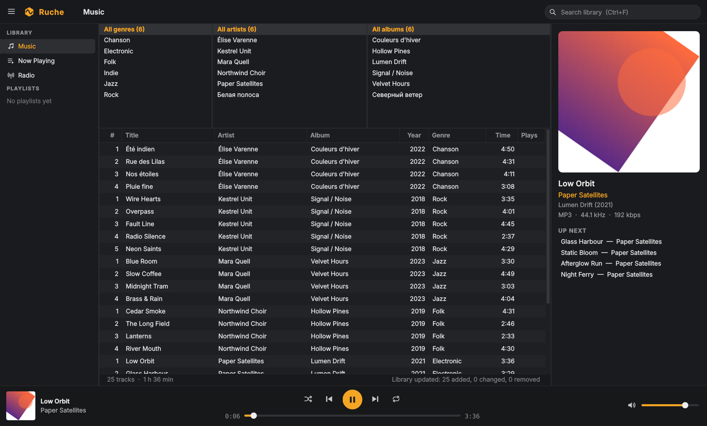
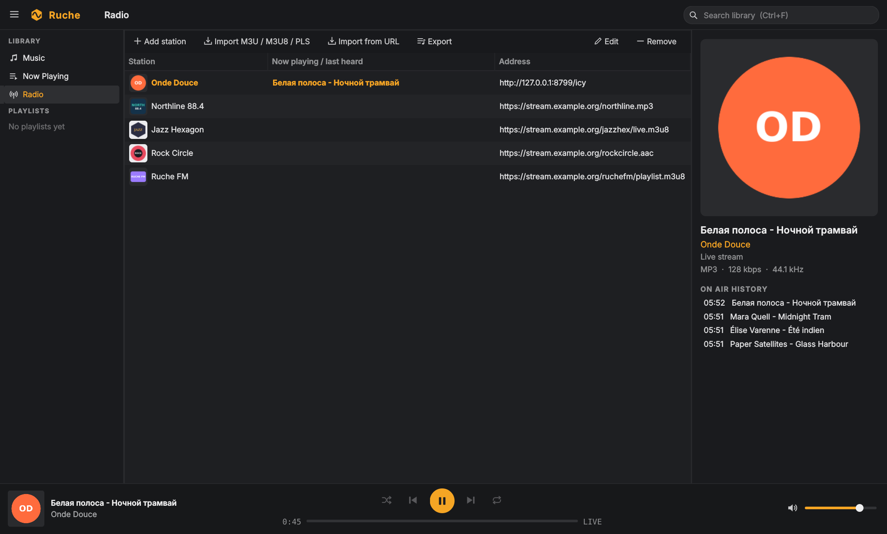
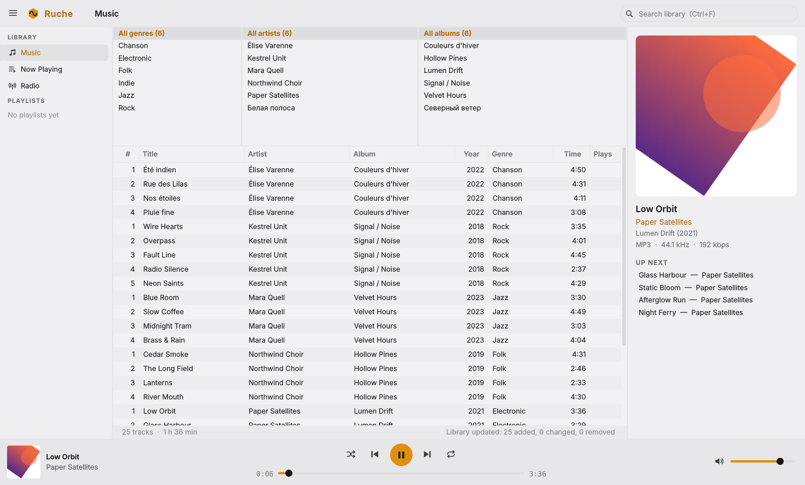
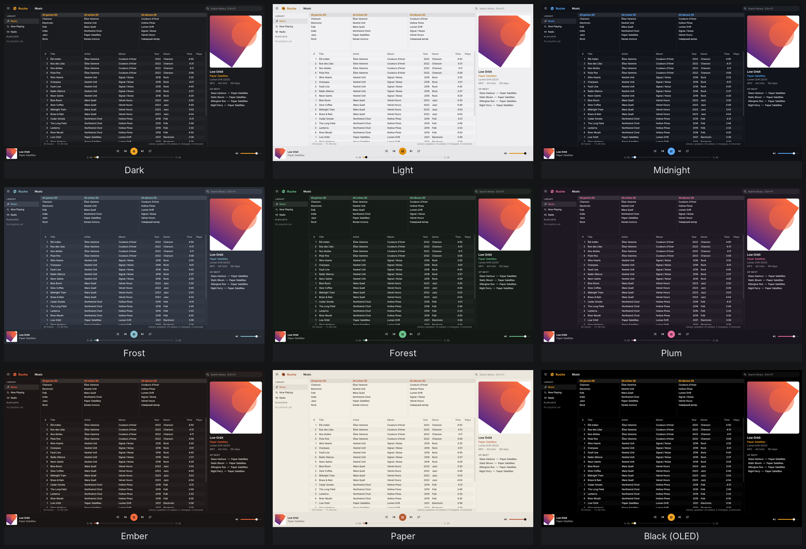
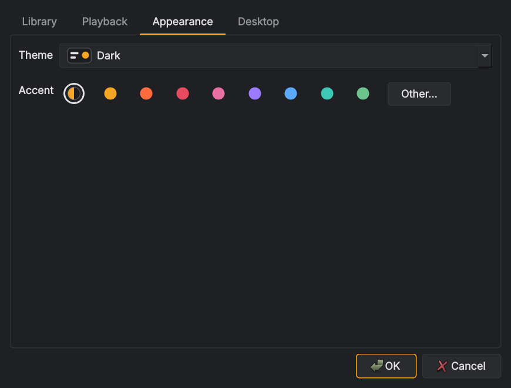

<p align="center">
  
</p>
<h1 align="center">Ruche</h1>
<p align="center">
  A light music player for Linux and Windows, laid out like MusicBee,<br>
  with live radio titles that actually follow the audio.
</p>
<p align="center">
  
</p>

Navigator on the left, Genre / Artist / Album column browser over the track list,
now-playing panel with art and up-next on the right, player bar at the bottom.
It is a from-scratch Qt 6 program. No MusicBee code is used.

## Install

| System | File | How |
|---|---|---|
| Fedora 40+, openSUSE Tumbleweed | `ruche-<version>-1.x86_64.rpm` | `sudo dnf install ./ruche-<version>-1.x86_64.rpm` |
| Ubuntu 24.04+, Debian 13 | `ruche_<version>-1_amd64.deb` | `sudo apt install ./ruche_<version>-1_amd64.deb` |
| Any Linux with Flatpak | `ruche-<version>.flatpak` | `flatpak install --user ruche-<version>.flatpak` |
| Any recent Linux (glibc 2.39+) | `Ruche-<version>-x86_64.AppImage` | make it executable and run it |
| Windows 10/11, 64-bit | `Ruche-<version>-windows-x64-setup.exe` | run the installer |
| Windows, portable | `Ruche-<version>-windows-x64.zip` | unzip, run `Ruche.exe` |

The Windows files aren't code-signed, so SmartScreen may warn the first time
(More info → Run anyway). What changed in each version: [CHANGELOG.md](CHANGELOG.md).

## What it does

- Library: scans folders with TagLib (MP3, FLAC, Ogg, Opus, M4A/ALAC, WAV, WavPack, APE,
  AIFF, WMA, MPC, TTA), keeps it in SQLite, browses by genre, artist and album, and searches
  ignoring accents ("ete" finds "Été").
- Playback through libmpv: gapless, ReplayGain (Settings), shuffle and repeat.
- Library tabs: keep folders apart, say Music in one tab and radio airchecks in another.
- Playlists are plain `.m3u8` files in `~/.local/share/ruche/playlists`.
- Radio: Icecast/Shoutcast, `.pls`, M3U/M3U8 station lists, and HLS (`.m3u8`) streams.
  Import a list from a file or URL, or pass it on the command line: `ruche mes-radios.m3u8`.
- Station logos, shown in the station list, the now-playing panel, the player bar and
  MPRIS (desktop media widgets). See "Station logos" below.
- Song notifications: a pop-up with the title, artist and cover (or station logo) when a
  track starts or the radio title changes. See "Song notifications" below.
- Plugins in Lua: react to songs, control playback, add menu entries, call web services.
  Comes with a sleep timer, a ListenBrainz scrobbler and a now-playing file for OBS.
  See "Plugins" below and [PLUGINS.md](PLUGINS.md).
- Discord Rich Presence (opt-in), with Discord or Vesktop.
- MPRIS, so media keys, desktop widgets and `playerctl` work.
- Updates itself from GitHub releases, if you allow it on first start (or from About).
- In 18 languages besides English (see "Languages" below).
- Runs natively on Wayland (KDE Plasma, Sway, …) and on X11.
- Themes: Dark (default), Light, Match the system, and Midnight, Frost, Forest, Plum, Ember,
  Paper and Black (OLED), with any accent colour, or a custom theme from your own background
  and text colours. Icons are drawn in code, so they follow the theme.

## Screenshots

<table>
  <tr>
    <td></td>
    <td></td>
  </tr>
  <tr>
    <td align="center">Radio, with station logos and the on-air history</td>
    <td align="center">Light theme</td>
  </tr>
</table>

<p align="center">
  <br>
  The built-in themes. Any of them takes any accent colour; you can also build your own.
</p>

<p align="center">
  
</p>

## Stream titles

| Stream | Where titles come from | How Ruche handles it |
|---|---|---|
| Icecast / Shoutcast | ICY `StreamTitle` | mpv's timed metadata, decoded as UTF-8 or Windows-1252 (not mpv's guess, which turns Latin-1 "Céline" into "CÚline"); double-encoded "Céline" is repaired |
| Ogg / Opus chains | in-band tags | from mpv |
| HLS with `#EXTINF:…,Artist - Title` | playlist | local relay reads every playlist |
| HLS, packed audio (AAC/MP3 segments) | ID3 at segment start and mid-segment | local relay parses each segment |
| HLS, MPEG-TS segments | ID3 timed-metadata PID (PES PTS) | local relay parses each segment |
| HLS, fMP4 segments | `emsg` boxes carrying ID3 | local relay parses each segment |

The relay is a small HTTP server on 127.0.0.1. mpv fetches the stream through it, so nothing
is downloaded twice. Each title is placed at the time where it occurs in the audio and
shown when playback reaches that time.

`tests/run_title_tests.sh` checks this against a local live-radio simulator. Each
title appears within 0.2 s of the moment it starts in the audio. With the relay turned off
(`RUCHE_NO_HLS_RELAY=1`), plain mpv shows no titles for the EXTINF and MPEG-TS streams and
misses changes on packed audio.

`RUCHE_DEBUG=1 ruche <url>` prints what the relay sees for each playlist and segment.

## Station logos

- Importing an M3U/M3U8 list keeps each entry's `tvg-logo`. Ruche downloads the logos in
  the background and saves them.
- For one station, use the Edit dialog (Choose image… / Paste / Remove, or a web address),
  right-click the station, drop an image file or browser image onto its row, or select it
  and press Ctrl+V.
- PNG, JPEG, SVG, WebP, ICO, GIF and BMP are accepted. Logos are trimmed of empty
  transparent margins, scaled to at most 256 px and stored as PNG in
  `~/.local/share/ruche/logos`, so they still show offline. A logo used by several
  stations is stored once.
- Dark artwork on a transparent background gets a light tile so it stays visible on the
  dark theme.
- **Export** in the Radio view writes the station list back to M3U8 with `tvg-logo` kept:
  the original web address when there is one, otherwise the saved file.

## Wayland

On a Wayland session Ruche uses Qt's native Wayland backend, except on GNOME, where it
runs through XWayland because GNOME does not draw window frames for Wayland apps. KDE's
KWin draws the usual Breeze frame. The taskbar icon on Wayland comes from the launcher
(see below), so turn on "Show in applications menu" to get the honeycomb icon there.
`QT_QPA_PLATFORM=xcb` or `=wayland` overrides the choice.

## Packages

Besides the AppImage there are `ruche_<version>-1_amd64.deb` (Ubuntu 24.04+, Debian 13) and
`ruche-<version>-1.x86_64.rpm` (Fedora 40+, openSUSE Tumbleweed). They hold the same program
as the AppImage under `/opt/ruche`, with `ruche` on the PATH, a menu entry and icons, so
there's nothing to set up: install with `sudo apt install ./ruche_….deb` or
`sudo dnf install ./ruche-….rpm`. Ruche can install a newer package itself (see "Updates");
otherwise updating is installing the newer package.

## Taskbar and applications menu

In **Settings → Desktop**, tick **Applications menu**. Ruche writes a launcher to
`~/.local/share/applications/ruche.desktop` and its icon (SVG plus PNGs) to
`~/.local/share/icons/hicolor`. Then pin it from your applications menu or from the
running window's taskbar entry. Untick it to remove the launcher and icon. (The .deb and .rpm add their own menu entry,
so the option isn't shown there.)

The launcher starts a small script (`~/.local/share/ruche/launch`) instead of the AppImage
itself. If the AppImage is gone (replaced by a newer version, renamed or moved), the script
starts the newest `Ruche*.AppImage` next to where it was, or in `~/Applications`,
`~/.local/bin`, `~/bin` or your Downloads folder, so a pinned taskbar entry keeps working.

The launcher refers to the icon by its full path, so KDE's icon cache can't keep showing
a stand-in. Each start from the AppImage brings an existing launcher up to date: a moved
or renamed AppImage, or a newer version's launcher or icon. If a pinned taskbar entry
still shows the old icon, unpin and pin it again.

From a terminal, `--install-desktop-entry` and `--remove-desktop-entry` do the same. They,
and `--play-pause`/`--next`/`--previous`, work without a display (TTY, SSH, scripts).

## Settings

☰ → Settings… has these tabs:

- **General**: language, and whether to check for updates on start.
- **Library**: tabs and the music folders in each.
- **Playback**: ReplayGain.
- **Appearance**: theme and accent colour. Changes show straight away; Cancel puts the old
  look back. "Match the system" follows the desktop's dark/light setting as it changes.
  A custom theme takes a background and a text colour (plus the accent) and mixes every
  other shade from them; accent colours that would be hard to read as text are darkened
  or lightened for text automatically.
- **Desktop**: song notifications, close to tray, Discord, applications menu (AppImage).
- **Plugins**: turn plugins on and off, configure them, read their logs.

## Updates

The first time Ruche starts, it asks whether to check for a new version on each start.
The answer can be changed in Settings → General, and **About Ruche → Check for updates**
checks at any time. A check asks GitHub for the newest release of
[jenaj97g/Ruche](https://github.com/jenaj97g/Ruche/releases); nothing else is sent.

When there is a newer version, Ruche shows its release notes and offers **Update now**,
**Skip this version** or **Later**. Every download is checked against the release's
`SHA256SUMS` file and thrown away if it doesn't match. What "Update now" does depends on
how Ruche was installed:

| Installed as | Update now |
|---|---|
| AppImage | downloads the new AppImage next to the old one, removes the old one and restarts; the menu launcher follows it |
| .deb / .rpm | downloads the package and installs it with `pkexec` (asks for your password), then restarts |
| Flatpak | downloads the bundle to Downloads and opens it in your software centre |
| Windows installer | downloads and runs the new installer, which closes and restarts Ruche |
| Windows zip | downloads the new zip to Downloads; unzip it over the old folder |

## Library tabs

With more than one music folder you can split them into tabs, for example **Music** and
**Airchecks**. In Settings → Library, add tabs, then choose a tab for each folder. With two
or more tabs a tab bar shows above the library; each tab has its own genres, artists and
albums. Double-click a tab to rename it; right-click for Rename and Tabs and folders. A
folder added from ☰ → Add music folder… goes into the tab you're on.

## Languages

English (default), Belarusian, Catalan, Chinese (Simplified), Czech, Dutch, French,
German, Hungarian, Irish, Japanese, Portuguese (Portugal), Portuguese (Brazil), Romanian, Russian, Serbian
(Cyrillic and Latin), Spanish and Swedish. Ruche follows the system language; Settings →
General picks another one.

The translations were machine-made and may have mistakes. To fix one, edit
`i18n/text/<code>.txt` (one `number<TAB>translation` per line; the numbers refer to
`i18n/strings.json`), run `python3 i18n/build.py`, which checks that `%1`, HTML and file
patterns survived, and send a pull request. For a new language, start from
`i18n/ruche_template.ts` in Qt Linguist, or copy a text file. Cherokee isn't included:
it needs a native speaker to translate it, and the template is there for one.

## Song notifications

Pick when they appear in **Settings → Desktop → Song notifications**:

- **When Ruche isn't the active window** (the default): you hear a new song while working
  in another window and see what it is, without being told what's already on screen.
- **Always**
- **Off**

Library tracks show the title, then artist and album, with the cover. Radio shows the
current title split into song and artist when it reads "Artist - Title", the station name
and its logo. Each new pop-up replaces the previous one instead of piling up, and they stay
out of the notification history. On Linux the pop-up has a **Next** button while there's a
next track; clicking the pop-up brings Ruche to the front.

On Linux they go to the desktop's notification service (KDE, GNOME, Xfce, dunst, mako…).
On Windows they are Windows notifications sent from Ruche's tray icon, so the tray icon
stays while they're on.

## Plugins

Plugins are Lua scripts. Ruche comes with three, listed in Settings → Plugins and off
until you tick them:

- **Sleep timer**: ☰ → Plugins → "Sleep in 30 minutes" (15, 30, 60, 90); the last
  30 seconds fade out, then playback pauses and the volume goes back to where it was.
- **ListenBrainz**: sends your listens to [ListenBrainz](https://listenbrainz.org) once
  you've heard half a song or four minutes. Put your user token in Configure…. Radio songs
  are left out unless you turn them on.
- **Now playing file**: keeps a text file with the current song ("Artist - Title", or your
  own format), for OBS text sources and other stream overlays.

Your own plugins go in `~/.local/share/ruche/plugins` (Windows:
`%LOCALAPPDATA%\ruche\plugins`; Flatpak: `~/.var/app/be.weizkule.Ruche/data/ruche/plugins`).
How to write one, and the whole API: [PLUGINS.md](PLUGINS.md).

## Discord

Settings → Desktop → **Show what I'm listening to on Discord**. It's off until you turn it on.

Discord then shows "Listening to Ruche" with the song, the artist, the album cover and a
progress bar. While paused or stopped, nothing is shown.

- **Album covers**: Discord can only show pictures that are on the web, so Ruche looks the
  cover up by artist and album on iTunes, then on MusicBrainz / Cover Art Archive, and
  remembers what it found. Untick "Show album covers" to keep that from happening (Ruche's
  logo is shown instead).
- **Radio**: only a clean "Artist - Title" is shown, with the station's logo (when Ruche
  downloaded it from a web address). Whatever else a station puts in its title, such as
  slogans, web addresses, frequencies or ads, never reaches Discord; it shows the station's
  name instead. "Include radio stations" turns radio off entirely.

It talks to Discord through Discord's local socket, so it works with the Discord app
(stable, PTB, Canary) and with **Vesktop**, whether installed natively, as a Flatpak or
as a Snap, and with Discord on Windows. In Vesktop, the "arRPC" (Rich Presence) option
must be on. The status line under the option says whether Ruche found Discord.

Discord needs an **application ID**: the name of the application is what appears after
"Listening to". To make one: [discord.com/developers/applications](https://discord.com/developers/applications)
→ New Application, name it "Ruche"; under Rich Presence → Art Assets, upload
`assets/logo-512.png` with the name `ruche`; copy the Application ID into Settings →
Desktop. (Builds made with `-DRUCHE_DISCORD_CLIENT_ID=<id>` have it filled in already.)

## Flatpak

`ruche-<version>.flatpak` is a single-file bundle. `flatpak install --user` fetches the
runtime it needs (org.freedesktop.Platform 24.08) from Flathub the first time. It can read
your home folder and `/media`, `/run/media`, `/mnt` (for music on other drives), plays
through PipeWire or PulseAudio, and can reach Discord's and Vesktop's sockets.

Its library, stations and settings are separate from the AppImage's or the package's:
they live in `~/.var/app/be.weizkule.Ruche/`. Updating is installing the newer bundle.

## Close to tray

Tick **Close to tray** in Settings → Desktop. Closing the window then hides it
and Ruche keeps playing from the system tray (KDE, and any desktop with a
StatusNotifierItem tray). Left-click the tray icon to show or hide the window, middle-click
to play or pause, and right-click for play/pause, next, previous, show and quit. The
tooltip shows what's playing. Quit from the tray menu, the ☰ menu or Ctrl+Q; logging out
closes it normally.

Only one Ruche runs at a time. Starting it again, from the taskbar or with files, hands
over to the open window and raises it. `--new-instance` overrides this. The launcher's
right-click menu has Play / Pause, Next track and Previous track, which are also available
as `--play-pause`, `--next` and `--previous`.

## Memory

Measured on the AppImage under Xvfb with `tests/measure_ram.sh`:

| | RSS | heap etc. (RssAnon) |
|---|---|---|
| idle, 20,000-track library | ~65 MiB | |
| playing a FLAC album | ~59 MiB | ~11 MiB |
| Icecast stream | ~67 MiB | |
| HLS through the relay | ~68 MiB | |
| HLS through the relay, Wayland | ~77 MiB | ~21 MiB |

On Wayland, Qt keeps two or three copies of the window image in shared memory (about
13 MiB for a 1360×820 window) where X11 keeps one.

Most of the RSS is read-only code pages (Qt, ICU, libc). The AppImage also runs a small
helper process (~9 MiB) that serves the mounted image. Start with
`APPIMAGE_EXTRACT_AND_RUN=1` to unpack once into `~/.cache` and skip the helper.

How it stays small:
- A purpose-built libmpv (`packaging/build-deps.sh`). It has audio decoders only, PipeWire
  and ALSA outputs, and FFmpeg and libplacebo linked in statically. It needs 23 libraries;
  Ubuntu's libmpv pulls in about 230 (speech synthesis, SVG, Vulkan, Samba…), which cost
  about 30 MiB per process to load.
- A stand-in `libproxy.so.1` that reads `http(s)_proxy`/`no_proxy`. The real libproxy loads
  curl, GnuTLS, Kerberos, LDAP and a JavaScript engine into QtNetwork.
- mpv's cache is capped at 4 MiB ahead and 256 KiB behind. The default keeps up to 50 MiB
  of already-played radio.
- Two malloc arenas, freed memory is returned to the system regularly, and cover art is
  decoded straight to display size.

## Windows

`Ruche-<version>-windows-x64-setup.exe` installs Ruche (Start menu entry, "Open with" for
audio files and playlists, uninstaller). `Ruche-<version>-windows-x64.zip` is the same
program as a portable folder: unzip and run `Ruche.exe`. Windows 10 or 11, 64-bit.

Everything above works the same, with these differences:

- Media keys work while another window has the focus (Ruche registers them as hotkeys).
  There is no MPRIS on Windows, so the volume pop-up's media controls don't show Ruche.
- Starting Ruche again, or opening a file with it, hands over to the open window, through
  a local pipe instead of D-Bus. `--play-pause`, `--next` and `--previous` work too.
- Audio goes through WASAPI. Library, stations, logos and settings live in
  `%LOCALAPPDATA%\ruche`.
- "Show in applications menu" isn't there; the installer adds the Start menu entry.

## Building

```sh
# app only, against the system libmpv
cmake -S . -B build && cmake --build build -j
build/test_meta              # parser unit tests

# AppImage (Ubuntu 24.04 build host)
DEPS=$HOME/deps packaging/build-deps.sh       # lean libmpv from Ubuntu's source packages
DEPS=$HOME/deps packaging/build-appimage.sh   # -> dist/Ruche-<version>-x86_64.AppImage
packaging/build-packages.sh                   # -> dist/ruche_<version>-1_amd64.deb, ruche-<version>-1.x86_64.rpm
packaging/flatpak/build-flatpak.sh            # -> dist/ruche-<version>.flatpak
```

`i18n/build.py` turns `i18n/text/*.txt` into the `.qm` files compiled into Ruche; run it
after changing a translation. `python3 i18n/build.py --extract` refreshes
`i18n/strings.json` after UI text changes in the code.

### Releases

`DEPS=$HOME/deps WIN=$HOME/win packaging/release.sh` builds every package into `dist/`
and writes `dist/SHA256SUMS`. Make a GitHub release tagged `v<version>` and upload the
packages and `SHA256SUMS`. The updater looks for these exact file names, and won't install
anything if `SHA256SUMS` is missing. Builds point at `jenaj97g/Ruche`; a fork sets
`-DRUCHE_UPDATE_REPO=owner/repo` at configure time.

Add `-DRUCHE_DISCORD_CLIENT_ID=<id>` to the CMake configure step to build in a Discord
application ID.

Windows, cross-compiled on Ubuntu 24.04 with mingw-w64:

```sh
packaging/windows/build-deps-windows.sh   # Qt 6.8, lean libmpv, TagLib, SQLite -> ~/win/prefix
packaging/windows/build-windows.sh        # -> dist/Ruche-<version>-windows-x64.zip and -setup.exe
```

The Windows libmpv is built the same lean way as the Linux one (audio decoders only,
FFmpeg linked in statically) with Schannel for HTTPS and WASAPI for output.

The AppImage runtime (`packaging/runtime.c`) is built from Ubuntu's squashfuse and libfuse3.
If FUSE is missing it falls back to extracting the image. It supports
`--appimage-extract`, `--appimage-extract-and-run`, `--appimage-mount` and `--appimage-offset`.

The image is built on Ubuntu 24.04, so it needs glibc 2.39 or newer: Ubuntu 24.04+,
Debian 13, Fedora 40+, Arch, openSUSE Tumbleweed. Debian 12 is too old.

Audio goes to PipeWire directly or to ALSA. On a PulseAudio-only system, ALSA's pulse
plugin carries it.

`tests/fake_discord.py` is a stand-in for Discord's RPC socket that logs what Ruche
sends. `tests/fake_notifyd.py` is a stand-in notification server that logs what Ruche sends
(`dbus-run-session`, then run it next to Ruche).

## Licence

GPL-3.0-or-later. libmpv is GPL; Qt and TagLib are LGPL. Lua (in `src/3rdparty/lua`) is
MIT-licensed; see its LICENSE file.
